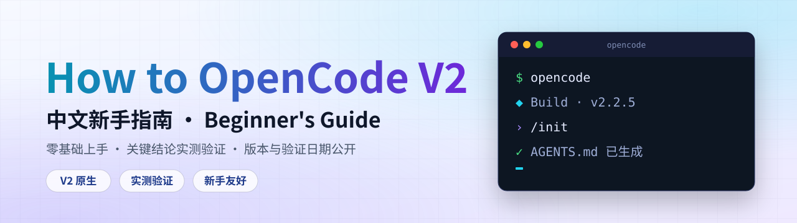

<div align="center">

<picture>
  <source media="(prefers-color-scheme: dark)" srcset="Assets/Brand/banner-dark.svg">
  
</picture>

<br>

[](LICENSE)
[](VERSION.md)
[](VERSION.md)
[](https://github.com/AutoBlaze/How-to-OpenCodeV2/stargazers)
[](https://github.com/AutoBlaze/How-to-OpenCodeV2/network/members)

**简洁、高效、每条结论都有出处的 OpenCode V2 中文入门教程**

[快速开始](#quick-start) · [章节地图](#chapters) · [常见问题](#faq) · [路线图](ROADMAP.md) · [参与贡献](#contribute)

</div>

---

## ✨ 为什么选这份指南

| | |
|---|---|
| **⚡ V2 原生**<br>全部内容按 OpenCode **V2**（v2.2.5）编写和核对，V1 与 V2 的差异只在必要处用一句话点明。 | **📐 实测验证**<br>关键结论在 V2 上实测，或对照官方文档，来源与待验证项公开在 [`VERSION.md`](VERSION.md)。 |
| **🧭 新手友好**<br>零编程基础也能跟着做：每一步都有目的说明、可直接复制的提示词和预期效果。 | **🛟 避坑手册**<br>收录真实踩过的坑：Leader 键要分步按、快捷键冲突、命令里的 `@` 不展开、环境变量对后台服务不生效…… |

---

## 🚀 快速开始 <a id="quick-start"></a>

**1. 安装 OpenCode**

```bash
# Windows（PowerShell）
npm install -g @opencode/cli

# macOS / Linux
curl -fsSL https://opencode.ai/v2/install | bash
```

> ⚠️ V1 和 V2 共用 `opencode` 命令，不能并存。装过 V1（包名 `opencode-ai`）的话，请先卸载：`npm uninstall -g opencode-ai`。

**2. 进入项目并启动**

```bash
cd ~/your-project
opencode
```

**3. 连接模型，开始第一次对话**

```text
/connect     # 选择模型提供商并粘贴 API Key
/models      # 选择模型（新手可直接用自带的免费模型）
/init        # 让 AI 分析项目，生成 AGENTS.md 规则文件
```

> 💡 想系统地学？从 [第一章](docs/01-meet-opencode.md) 开始，按顺序往下读。

---

## 🗺️ 学习路线


> 🟢 已完成　⚪ 规划中，详见 [路线图](ROADMAP.md)

---

## 📚 章节地图 <a id="chapters"></a>

| 章节 | 你将学会 | 状态 |
|------|----------|:----:|
| [**01 · 打开 OpenCode**](docs/01-meet-opencode.md) | 安装与启动、使用方式、CLI 与 TUI 常用命令、快捷键与 Leader 键、核心工具、Fork 会话 | ✅ |
| [**02 · 学习 AI Agent**](docs/02-use-ai-agent.md) | Primary 与 Subagent、内置 Agent、`@explore` / `@general`、撤销与恢复、TODO、`/init` 与 `AGENTS.md`、环境变量 | ✅ |
| [**03 · 自建写作 Agent**](docs/03-create-writing-agents.md) | 用 `AGENTS.md` 固化人设、自定义 Agent、素材库整理、自定义命令与参数、后台子代理 | ✅ |
| [**附赠 · Git 操作全流程**](docs/bonus-git-push-to-github.md) | 首次推送、日常更新、撤回操作 | ✅ |
| **04 · 权限与安全** | `permissions` 规则、`policies`、密钥保存、会话导出脱敏 | 🚧 |
| **05 · 模型与提供商** | `/connect` 多账号、免费模型、国产模型、本地模型、自定义 provider | 🚧 |
| **06 · 上下文与会话** | 上下文压缩、会话与标签页、快照与撤销的边界 | 🚧 |
| **07 · Skills** | 编写与加载 `SKILL.md`，与命令的区别 | 🚧 |
| **08 · MCP 与联网** | 接入 MCP 服务、联网搜索与网页抓取 | 🚧 |
| **09–12 · 高阶** | 桌面端与网页端、并行会话与 worktree、`opencode run` 自动化、插件 | 🚧 |

配置示例在 [`opencode_config/`](opencode_config/)：[`example_opencode.json`](opencode_config/example_opencode.json)（自定义模型提供商）、[`example_cli.json`](opencode_config/example_cli.json)（终端快捷键）、[`example_AGENTS.md`](opencode_config/example_AGENTS.md)（项目规则）。

---

## 👥 适宜人群

🆕 编程新手　·　💼 办公人员　·　🎨 内容创作者　·　🔧 开发者　·　📖 AI 工具学习者

> 💡 **不需要任何编程经验**，只要有学习的热情即可。

---

## ❓ 常见问题 <a id="faq"></a>

<details>
<summary><b>OpenCode 要付费吗？</b></summary>

OpenCode 本身免费开源。新手可以先用它自带的免费模型（有限额），也有自己的按月订阅服务OpenCode Go。还可以用 `/connect` 连接自己的模型 Key。详见 [第一章](docs/01-meet-opencode.md)。

</details>

<details>
<summary><b>我还在用 V1，怎么办？</b></summary>

V1 和 V2 共用 `opencode` 命令，需要先卸载 V1 再安装 V2。V1 的配置大部分在 V2 里继续可用，官方迁移指南见 [Migrate from V1](https://opencode.ai/v2/docs/migrate-v1/)。实在不会弄，可以让你现有的 Agent 帮你迁移（我就是这么干的）。

</details>

<details>
<summary><b>按了 Ctrl+X 之后快捷键没反应？</b></summary>

Leader 组合键要**分两步按**：先按 `Ctrl+X` 并松开，再单独按后面的字母，不能同时按。详见 [第一章](docs/01-meet-opencode.md) 的 Leader 键一节。

</details>

<details>
<summary><b>教程会多久更新一次？</b></summary>

尽管 OpenCode V2 更新很快，但教程内容的适用性很强，大家可以放心使用。我会陆续更新更多具有实践性的章节教程，也是记录自己的实践成果。每次OpenCode发布新的重要版本后，我会对照官方 changelog 核对教程，并在 [`VERSION.md`](VERSION.md) 更新适配版本、已实测结论和待验证清单。

</details>

---

## 🤝 参与贡献 <a id="contribute"></a>

发现错误、版本对不上、想补充内容？欢迎参与：

- 🐛 [提交勘误或版本不符](https://github.com/AutoBlaze/How-to-OpenCodeV2/issues/new/choose)
- 💡 [提出章节建议](https://github.com/AutoBlaze/How-to-OpenCodeV2/issues/new/choose)
- 🔀 发起 Pull Request，请先阅读 [贡献指南](CONTRIBUTING.md)
- ⭐ 觉得有用的话，点个 Star 就是最大的鼓励

**本项目作者**：AutoBlaze（自来火）

GitHub: [@AutoBlaze](https://github.com/AutoBlaze)　·　项目地址: https://github.com/AutoBlaze/How-to-OpenCodeV2

微博 [@AutoBlaze自来火](https://weibo.com/u/2159604590)

---

## 📄 License

本教程采用 <a href="https://creativecommons.org/licenses/by-nc-sa/4.0/deed.zh-hans" target="_blank">CC BY-NC-SA 4.0</a> 许可协议，完整条款见仓库根目录的 [LICENSE](LICENSE) 文件。

- ✅ 可自由分享、转载，需注明出处
- ✅ 可修改、演绎，需注明作者，以相同协议分享
- ❌ 禁止用于商业用途（付费课程、付费专栏、出版物等）

> ⚠️ **免责声明**：本教程仅供学习参考，使用 OpenCode 及相关工具时请遵守其官方使用条款。

---

## 🌟 致谢

感谢 OpenCode 团队提供如此优秀的 AI 编程助手。部分灵感来源于 GitHub 上的开源教程 “learn-opencode”。

更多参考教程：官方文档：[opencode.ai/v2/docs](https://opencode.ai/v2/docs/) ·　[learnopencode.com](https://learnopencode.com/)

<div align="center">

**Happy Coding! 🚀**

Made with ❤️ by AutoBlaze自来火


</div>
