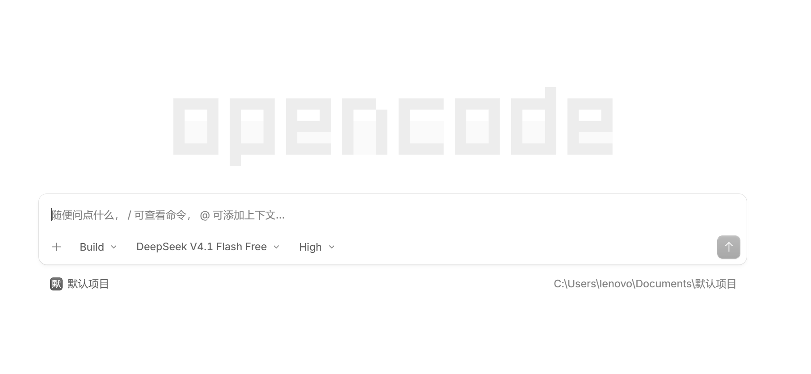
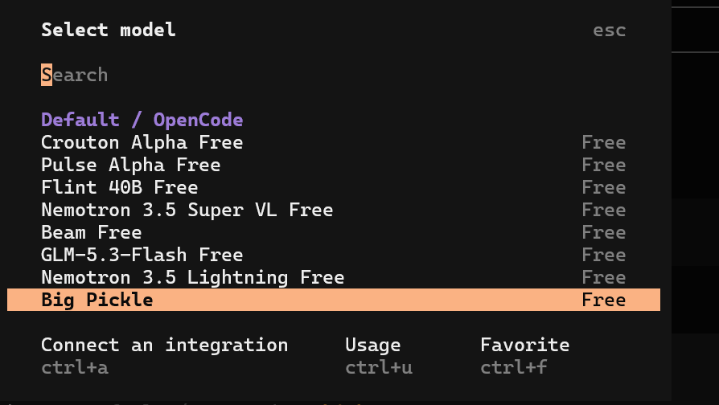

# 第一章：打开 OpenCode

> 📖 **CHAPTER #1**: Meet Your OpenCode

> 📌 **版本说明**：本章已按 **OpenCode V2**（实测版本 v2.2.5）更新。如果你还在用 V1，请参考官方的 [从 V1 迁移](https://opencode.ai/v2/docs/migrate-v1/) 指南。

---

## 📋 目录

- [什么是 OpenCode](#what-is-opencode)
- [安装 OpenCode](#install-opencode)
- [使用 OpenCode 的方式](#usage-modes)
- [启动 OpenCode 并进入项目](#start-project)
- [新手模型选择](#model-selection)
- [CLI 常用指令](#cli-commands)
- [TUI 常用指令](#tui-commands)
- [OpenCode 核心工具](#core-tools)
- [高级功能](#advanced-features)

---

## 💡 什么是 OpenCode <a id="what-is-opencode"></a>

OpenCode 是一个免费开源项目，是一个在终端里运行的 **AI 编程助手**，与几乎所有主流大模型都可以搭配使用，而且自带免费大模型可以免登录使用。目前已经迭代升级了一个大版本，现在主推V2版本。

你可以用它进行 **Vibe Coding**，你说一句话，它帮你：

- 📝 分析需求
- ✏️ 修改代码
- ⚡ 执行命令
- 🔄 自动完成多步任务

> 🎯 **目标**：不懂编程的普通人也可以用 OpenCode 写代码，做 App、协助办公，以及更多无限可能。

它被称为 **Claude Code** 的高性价比平替。对于国内用户，在 Anthropic **反花 + 封号 + 需要海外信用卡** 等缺点的情况下，OpenCode 确实是一个不错的选择。

---

## 🚀 安装 OpenCode <a id="install-opencode"></a>

> ⚠️ **前置要求**：用 npm 安装需要先安装 Node.js；`/undo`指令还原文件改动，项目还需要是 Git 仓库，所以建议同时安装 Git。

### Windows 常见安装方式

点击[官方下载页](https://opencode.ai/download)获取桌面端安装包

**或者**

进入 **管理员权限的 PowerShell**，输入：

```powershell
npm install -g @opencode/cli
```

安装完成后验证版本号，应显示 `2.x`：

```powershell
opencode -v
```

> ⚠️ **注意**：V1 和 V2 共用同一个 `opencode` 命令，不能并存。如果你之前装过 V1（包名 `opencode-ai`），请先卸载：
>
> ```powershell
> npm uninstall -g opencode-ai
> ```
**或者**

**也许是最好的方式**：直接让你现有的 **Agent 帮你**安装或升级V2！（我就是这么干的）

---

## 📌 使用 OpenCode 的方式 <a id="usage-modes"></a>

### 1. 桌面端与网页端

> 💡 **推荐**：新手无脑选，可视化、界面友好

OpenCodeV2 提供了独立的**桌面应用**（官方下载页获取安装包https://opencode.ai/download

用起来就像是一个**无广告、简洁版**的WorkBuddy。如果你用过Codex、WorkBuddy、Claude Code，那就更容易适应了。基本各家桌面端的功能都在无限趋同。


>💡**但是注意**：OpenCode是**极简主义风格**，桌面端有时候还是需要搭配一些CLI指令使用。

网页端：可以在终端运行CLI指令 `opencode pair` 获取一次性链接，在浏览器里使用。
>  **提示**：链接 5 分钟内有效，且只能使用一次。

### 2. 终端直接使用

> 💡 **推荐**：最经典、最稳定

在 PowerShell/CMD 里直接使用，稳定，但是对于编程新手需要适应终端界面和指令操作（但其实也没那么难）。

建议同时掌握两种方式，桌面端和终端各有优势，互为补充。


### 3. VS Code / Cursor IDE

先安装 OpenCode，再在 VS Code 里安装 OpenCode 插件（插件 ID：`sst-dev.opencode`）。

> ✅ **优点**：
> - 适配程序员编程习惯
> - 实时看到文件资源器
> - 可视化 GitHub 管理

> ⚠️ **注意**：插件需要 **v1.0.0 及以上版本**才能配合 V2 使用，旧的 0.0.13 版本在 V2 下会报错 `Unrecognized flag: --port`。如果不想装插件，直接在 VS Code 的内置终端里输入 `opencode` 同样可以用。

---

## ⚡ 启动 OpenCode 并进入项目 <a id="start-project"></a>

桌面端：直接双击图标进入，可以选择某个本地文件夹作为项目地址。

使用终端：在 PowerShell/CMD 里逐行输入：

```PowerShell
cd path\to\nested\folder  # 切换到已有文件夹地址，把文件地址换成你的项目绝对路径
opencode
```
或者
```PowerShell
mkdir path\to\nested\folder  # 新建文件夹地址，把文件地址换成你的项目绝对路径。
cd path\to\nested\folder  # 再切换到已有文件夹地址
opencode
```

💡<font color="blue">**小技巧**</font>：Windows系统在**文件夹的地址栏**里直接输入cmd或powershell，即可以进入终端。此时终端工作目录就是刚才的文件夹目录，非常方便。这是我最常用的方式。

---

## ✅ 新手模型选择 <a id="model-selection"></a>

> 💡 **建议**：新手优先使用 OpenCode 自带的免费 Model，免登录，不需要配置 API KEY，不折腾，打开即用。这也是OpenCode最大方、最新手友好的优点之一。

⚠️ **缺点**：短时间内不能连续使用太多次，有 rate limit（速率限制）

💡 **提示**：免费模型的名单会不定期调整，在聊天框里输入 `/models` 查看当前可用的free模型。


---

## 🖥️ 聊天框常用指令（适用桌面端和终端TUI） <a id="tui-commands"></a>

> 📖 **说明**：TUI 指令一般指从终端或者 IDE 进入 OpenCode 之后在聊天框里使用的指令

### 用 `/` 调用斜杠命令

| 命令 | 作用 |
|------|------|
| `/help` | 查看帮助 |
| `/new` | 新建会话 |
| `/models` | 选择模型 |
| `/agents` | 选择 Agent |
| `/connect` | 添加 Model Provider |
| `/init` | 创建或更新 AGENTS.md 文件 |
| `/sessions` | 选择对话 |
| `/compact` | 压缩过长的上下文 |
| `/undo` | 撤回上一步操作（还原文件需要 Git 配合） |
| `/redo` | 恢复被 `/undo` 撤回的内容 |
| `/fork` | 从某条消息处分叉出新会话 |
| `/btw` | 针对当前对话问一个临时问题，回答不会占用对话上下文 |
| `/themes` | 切换主题 |
| `/exit` | 退出（也可用 `/q`） |

> 💡 **提示**：输入 `/` 会列出当前所有可用命令，继续输入可以过滤。按 `Ctrl + P` 打开命令面板，可以看到当前界面下的全部操作。

> 💡 **常看常新**：https://opencode.ai/v2/docs/cli/tui

---

### 用 `@` 引用文件

> 💡 **这是 OpenCode 最强大的功能** —— 让 AI 直接读取你的文件

> ⚠️ **注意**：输入 `@` 后会看到 Agent 列表（如 `@explore`、`@general`）和文件。继续输入文件名的部分内容（如 `@pack`），才会搜索并显示匹配的具体文件，用方向键选择后按 `Enter` 确认。

还可以在文件路径后面指定行号或行范围：

```text
解释一下 @src/auth.ts#20-45
```

---

### 用 `!` 开头执行命令

在**空的输入框**开头输入 `!`，就会进入 shell 模式，可以直接在 OpenCode 里执行终端命令，减少不确定性，加快执行速度。按 `Esc` 可以退出 shell 模式。

```text
!git status
```

> 💡 **提示**：当然，不缺 Token 的话，可以尽量用自然语言让 AI 去执行终端命令。

---

## 🔧 CLI 常用指令 <a id="cli-commands"></a>

> 📖 **说明**：CLI 指令用于没有进入 OpenCode 之前，在终端PowerShell或CMD界面里使用。TUI 指令用于已通过终端进入到OpenCode里，在聊天框里使用。**使用桌面版可以先跳过**。

以 `opencode` 开头，加上下面后缀：

| 标志 | 简写 | 描述 |
|------|------|------|
| `--continue` | `-c` | 继续上一个会话，最常用的指令 |
| `--prompt` | - | 后面带上一句提示词，开启就开始对话 |
| `--auto` | - | 自动批准未被明确禁止的权限请求（谨慎使用） |
| `models` | - | 列出所有可用模型 |
| `models --refresh` | - | 更新缓存的模型列表。当提供商新增了模型时，此功能非常有用 |

> 💡 **提示**：`--fork`（继续时分叉会话）只在 `opencode run` 和 `opencode mini` 里可用，详见本章末尾的 Fork 会话。

### 更多CLI常用命令

```PowerShell
# 为提供商登录并保存密钥（不加参数会弹出提供商选择列表）
opencode auth login

# 列出所有已连接的提供商
opencode auth list

# 登出某个已保存的账号
opencode auth logout

# 切换提供商的当前不同API Key
opencode auth switch

# 列出当前项目的所有会话
opencode session list

# 只列出最近 N 个会话
opencode session list -n 10

# 不进入界面，直接发送一条消息并输出回复
opencode run "解释一下这个项目"

# 启动一个精简版交互界面
opencode mini

# 查看所有 Agent（含内置的隐藏 Agent）
opencode debug agents

# 更新到最新版本
opencode upgrade

# 更新到指定版本
opencode upgrade 2.2.5

# 查看版本号
opencode -v

# 密钥存储在本地 SQLite 数据库里，用下面的命令查看路径
opencode debug paths db
```

> 💡 **常看常新**：https://opencode.ai/v2/docs/cli/commands

---

### 常用快捷键

| 快捷键 | 作用 |
|--------|------|
| `Shift + Tab` | TUI里切换 Agent（Plan / Build 等），V2 默认键位 |
| `Ctrl + Enter` | 聊天框换行 |
| `Ctrl + P` | 打开命令面板 |
| `Esc` | 中断当前任务,按照提示按两次 |
| `Ctrl + C` | 不选中任何文本是清空输入框。选中文本则是复制 |
| `Ctrl + D` | 退出 OpenCode，返回终端 |
| `Shift + Enter` | 输入框里换行 |
| `Ctrl + X` | Leader 键（前缀键） |

> 📌 **关于 `Tab` 键**：V1 里切换 Agent 用 `Tab`，V2 官方默认改成了 `Shift + Tab`（`Tab` 用于补全）。如果你是从 V1 升级上来的，V2 首次启动会把旧的 `tui.json` 自动迁移到 `cli.json`，其中的 `agent_cycle: tab` 会被保留，所以 `Tab` 依然能切换。全新安装的 V2 请用 `Shift + Tab`；想继续用 `Tab`，在 `cli.json` 里设置 `"agent.cycle": "tab"` 即可（见 `opencode_config/example_cli.json`）。

> 💡 **提示**：AI 正在工作时，直接按 `Enter` 会"引导"当前任务；想把这条提示排队等它做完再执行，按 `Ctrl + X` 再按 `Enter`。

### Leader 键组合

> ⚠️ **重要：Leader 组合键要分两步按，不能同时按**
>
> 表格里写的 `Ctrl + X` → `n`，意思是：
>
> 1. 先按下 `Ctrl + X`，然后**松开**两个键（这时输入框会变灰，表示进入了"等待下一个键"的状态）
> 2. 再**单独**按一下 `n`
>
> 如果你把 `Ctrl`、`X`、`n` 三个键同时按下，是不会生效的。这和 Vim 的操作方式类似。
>
> 如果按完 `Ctrl + X` 后很久没按下一个键，会自动取消（默认等待 2 秒），重新按一次 `Ctrl + X` 即可；也可以按 `Esc` 手动取消。

| 快捷键 | 作用 |
|--------|------|
| `Ctrl + X` → `n` | 新建会话 |
| `Ctrl + X` → `l` | 会话列表 |
| `Ctrl + X` → `m` | 模型列表 |
| `Ctrl + X` → `a` | Agent 列表 |
| `Ctrl + X` → `u` | 撤回（`/undo`） |
| `Ctrl + X` → `r` | 恢复（`/redo`） |
| `Ctrl + X` → `e` | 用外部编辑器编写提示词 |

---

### 更多快捷键

| 功能 ID | 快捷键 | 说明 |
|---------|--------|------|
| `model.list` | `<leader>m` | 模型列表 |
| `model.cycle_recent` | `F2` | 切换最近模型 |
| `model.cycle_recent_reverse` | `Shift + F2` | 反向切换 |
| `agent.list` | `<leader>a` | Agent 列表 |
| `session.new` | `<leader>n` | 新建会话 |
| `session.list` | `<leader>l` | 会话列表 |
| `session.rename` | `Ctrl + R` | 重命名会话 |
| `session.compact` | `<leader>c` | 压缩上下文 |
| `session.sidebar.toggle` | `<leader>b` | 切换侧边栏 |
| `opencode.status` | `<leader>s` | 状态视图 |
| `session.first` | `Ctrl + G` / `Home` | 跳到第一条 |
| `session.last` | `Ctrl + Alt + G` / `End` | 跳到最后一条 |

> ⚠️ **迁移用户注意**：从 V1 升级时，旧的快捷键设置会被自动迁移进 `cli.json`，其中一些可能与 V2 新增的默认键位撞车，例如 `<leader>w`（V2 默认用来关闭标签页）、`<leader>t`（开关终端面板）、`<leader>↓` 和 `<leader>↑`（终端面板选择和关闭）。遇到 Leader 组合键行为异常时，删掉 `cli.json` 里对应的条目，就会恢复 V2 默认键位。

> 💡 **备注**：V2 的快捷键配置文件改成了 `~/.config/opencode/cli.json`（V1 的 `tui.json` 会在首次启动 V2 时自动迁移），功能 ID 也从下划线改成了点号。作者的自定义示例见 `opencode_config/example_cli.json`，完整的默认快捷键见官方 [Keybinds](https://opencode.ai/v2/docs/cli/keybinds)。

---

### 发现的问题

### ⚠️ 快捷键冲突

命令面板（`command.palette.show`）的默认快捷键是 `Ctrl+P`：

- **原生 PowerShell 或 CMD：**可以正常使用。
- **VS Code：**`Ctrl+P` 会打开 VS Code 的命令搜索界面，而不是 OpenCode。

> **解决方法：**若要在 VS Code 中使用该快捷键，请调整 VS Code 的快捷键设置。
---

## 🛠️ OpenCode 核心工具 <a id="core-tools"></a>

| 工具 | 作用 | 类比 |
|------|------|------|
| `read` | 读取文件或目录 | 打开文件看内容 |
| `write` | 创建或覆盖文件 | 另存为 |
| `edit` | 精确替换文件中的文本 | 查找替换 |
| `patch` | 一次修改多个文件（仅部分 GPT 模型使用，其他模型用 `edit` 和 `write`） | 批量改稿 |
| `shell` | 执行 Shell 命令 | 在终端敲命令 |
| `grep` | 按内容搜索文件 | 全局搜索 |
| `glob` | 按文件名搜索文件 | 文件管理器里搜文件名 |
| `subagent` | 创建子 Agent 处理复杂任务 | 创建帮手团队执行任务 |
| `webfetch` | 获取指定网页内容 | 打开网页看内容 |
| `websearch` | 联网搜索 | 搜索引擎 |
| `question` | AI 向你提问并让你选择 | 弹出选择题 |
| `todowrite` | 任务清单管理（**默认关闭**） | 复杂任务时创建任务清单，防止 AI "忘事"或"走偏" |
| `skill` | 加载专业知识包 | Skill 系列 |

### 额外说明

> 💡 **提示**：V1 的 `bash` 在 V2 里改名为 `shell`（模型仍调用 `bash` 时，会自动按 `shell` 执行，权限不变），`Task` 改名为 `subagent`。

> ⚠️ **注意**：`todowrite` 在 V2 里默认关闭。想让 AI 自动维护任务清单，需要在 `opencode.json` 里开启实验功能：
>
> ```json
> {
>   "experimental": {
>     "todo": true
>   }
> }
> ```

> ⚠️ **限制**：grep 和 glob 默认都最多返回 100 条结果。如果结果被截断，可以：
> - 缩小搜索目录（"只在 src 目录下搜索"）
> - 用更精确的关键词
> - 过滤文件类型（"只搜索 .ts 文件"）

> 💡 **提示**：你不需要手动调用这些工具。你只管用自然语言描述需求，AI 会自动选择合适的工具。

---

### 精确的 Edit 工具

💡 V2 的 Edit 工具采用**精确匹配**：`oldString` 必须和文件里的文本逐字一致（包括空格、缩进、制表符），并且在文件中只出现一次（除非使用 `replaceAll`）。

> 📌 **和 V1 的区别**：V1 的 Edit 工具有多层"模糊匹配"，缩进、空白略有差异也能改成功。V2 不再这样做，缩进对不上就会失败。

---

## 🚀 高级功能 <a id="advanced-features"></a>

### btw临时会话
> ❓ **为什么需要**？
> 有时候你想问一个和当前对话相关的临时问题，但又不想让这个问题和回答占用当前对话的上下文。/btw 就是干这个的。

⚙️ 它是如何工作的？
1. **携带当前上下文**：运行 `/btw <提问内容>` 时，OpenCode 会将最近几轮对话背景传递给子任务，让回答结合当前的代码背景。
2. **结果独立弹出**：回答会以独立弹窗（Dialog）的形式展现，不会插入当前聊天历史。
3. **主线不受影响**：关闭弹窗后，主会话（Main Session）会继续进行；临时提问不会影响后续的提示词（Prompts）。

### Fork 会话

> ❓ **为什么需要**？
> 有时候你想从对话的某个节点"分叉"出去，尝试不同的方向，但又不想丢掉原来的对话。Fork 就是干这个的。

Fork 会从会话的某条消息处"分叉"，创建一个带有之前历史的新会话。

⚙️ **操作方式**：

1. **桌面端**：在你发送的内容右下方点击“...”，选择“从此消息创建新会话”。
2. **TUI**：点击你发送的内容，从弹出的菜单里选择，或输入 `/fork`，然后选择要从哪条消息开始分叉。

> ✅ **预期效果**：出现一个新会话，包含分叉点之前的对话；原会话保持不变。

> 💻 **CLI 用法**：`--fork` 需要配合 `--continue` 或 `--session`，且只在 `run` 和 `mini` 中可用。

```powershell
opencode mini -c --fork
```

---

