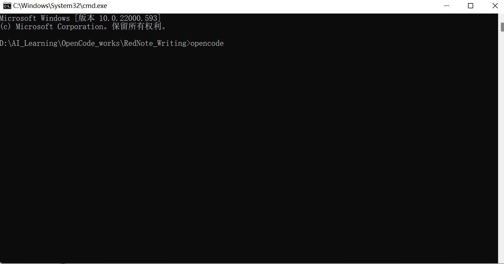
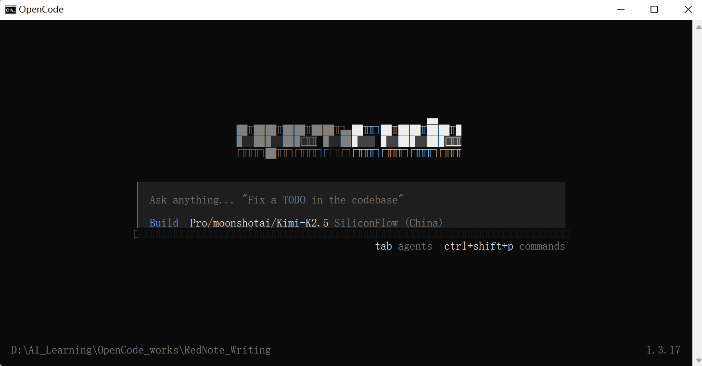
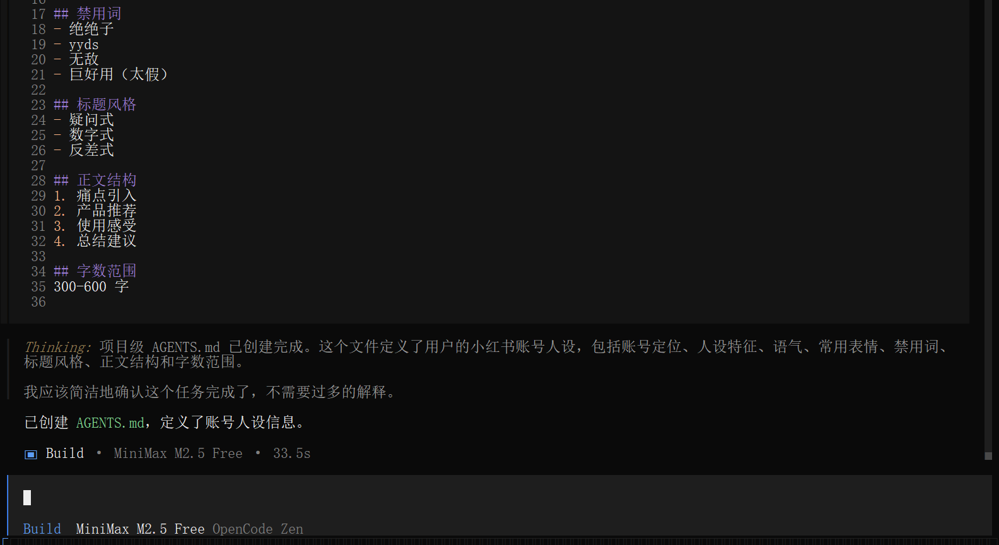
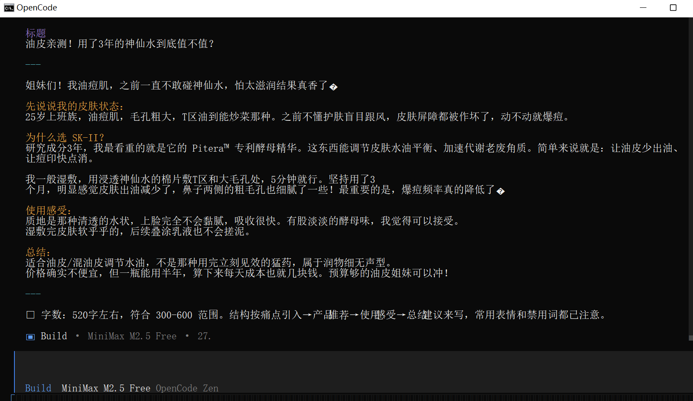
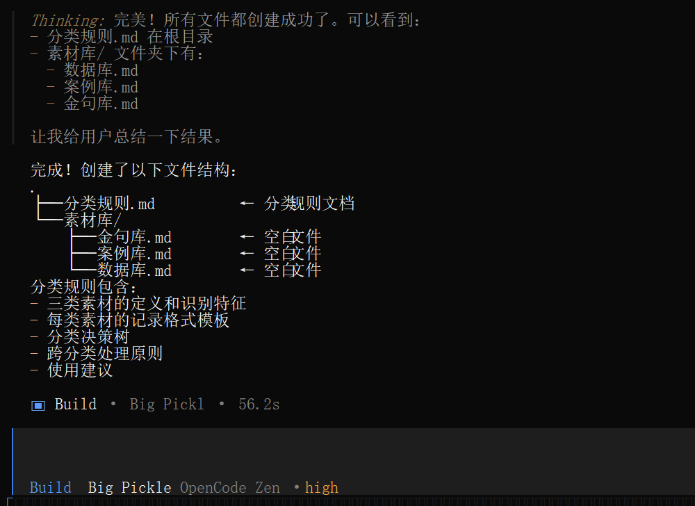
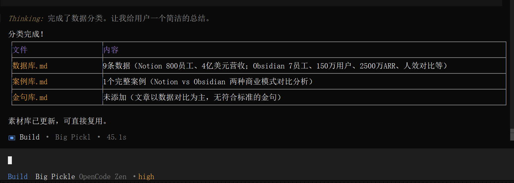
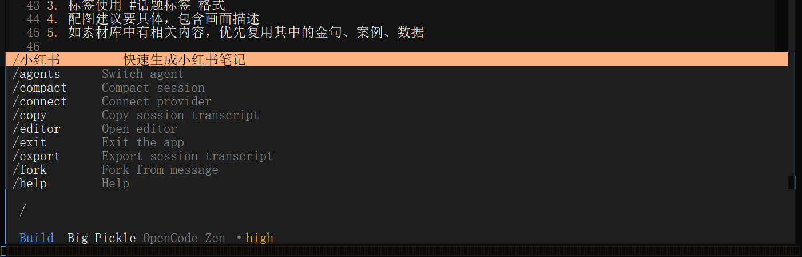

# 第三章：自建写作Agent

> 📖 **CHAPTER #3**: Create-Ur-Writing-Agents

> 📌 **版本说明**：本章已按 **OpenCode V2**（实测版本 v2.2.5）更新。

---

## 📋 目录

- [与网页版 AI 的区别](#与网页版-ai-的区别)
- [思维转变](#思维转变)
- [实操一：小红书文书 Agent](#实操一小红书文书-agent)
- [实操二：通过新建 Agent 固化写作风格](#实操二通过新建-agent-固化写作风格)
- [实操三：让 AI 整理文件](#实操三让-ai-整理文件)
- [进阶技巧](#进阶技巧)

---

## 💡 与网页版 AI 的区别 <a id="与网页版-ai-的区别"></a>

提问：我平时有问题直接问豆包、DeepSeek 就行了呀，为什么要用 OpenCode

| 能力 | 网页版 AI | OpenCode |
|------|-----------|----------|
| 内容输出 | ❌ 只能复制粘贴 | ✅ AI 执行，直接写入文件 |
| 人设一致性 | ❌ 每次重新描述 | ✅ AGENTS.md 固化，永久生效 |
| 多文件管理 | ❌ 无法管理多文件 | ✅ 项目化结构，资源管理器 |
| 素材库调用 | ❌ 无法读取本地文件 | ✅ @素材 引用历史内容 |
| 版本管理 | ❌ 无法实现 | ✅ Git 追踪创作历史 |

---

## ⚡ 思维转变 <a id="思维转变"></a>

一针见效，发挥 OpenCode 的优势：

1. 🚀 一定善用 Plan 模式，再用 Build 模式
   - 构思(Plan)→输出(Build)→迭代(Build)

2. 📌 善用 @文件名 精确指定文件/精确对已有内容进行修改

> 💡 **提示**：这些都是网页版 AI 不易做到的。

---

## 🚀 实操一：小红书文书 Agent <a id="实操一小红书文书-agent"></a>

**学习目标**：善用 AGENTS.md 固化 AI 规则

通过项目级 AGENTS.md 固化 AI 的人设一致性，不用每次重复输入 prompt。

> 📌 **知识点回顾**：AGENTS.md 是 OpenCode 一个固定名称的配置文件，既可以放在 OpenCode 的全局配置目录 `~/.config/opencode/`（全局级），也可以放在项目工作目录（项目级）。V2 只识别 `AGENTS.md` 这个名字。

### 一起做

在合适的地方创造一个文件夹叫 `RedNote_Writing`，此时这个文件夹是空的。在文件夹地址栏输入 `cmd`，输入 `opencode`，回车。



进入 OpenCode 初始欢迎界面。



- 直接使用免费模型（可输入 `/models` 选择模型）
- 在这里我们直接用 build 模式（用 `Shift + Tab` 切换 Agent，详见第一章"关于 Tab 键"）

输入以下 prompt：（如果 Ctrl+V 不能粘贴，试试 Shift+右键）

---

```
创建项目级 AGENTS.md，定义我的小红书账号人设：

账号定位：护肤成分党
人设：25 岁上班族，油痘肌，研究成分 3 年
语气：闺蜜分享式，真诚不装
常用表情：✨ 💕 🌟 😭 ❗
禁用词：绝绝子、yyds、无敌、巨好用（太假）
标题风格：疑问式/数字式/反差式
正文结构：痛点引入 → 产品推荐 → 使用感受 → 总结建议
字数范围：300-600 字
```



执行完毕，检查 AGENTS.md 文件是否真的创建。

现在再输入以下 prompt，测试 AI 人设：

```
写文推荐 Sk-II的保湿水
```



---

## 📝 实操二：通过新建 Agent 固化写作风格 <a id="实操二通过新建-agent-固化写作风格"></a>

写一次，永久生效，不用每次重复描述。

> 💡 **提示**：Agent 配置可以放在两个位置：
> - 全局：`~/.config/opencode/agents/` - 所有项目共用
> - 项目级：`.opencode/agents/` - 当前项目专用
> - 文件名就是 Agent 名称，例如 `novelist.md`（注意路径不是 `novelist/novelist.md`）
> - 文件正文就是这个 Agent 的系统提示词，不需要在开头写 `name:`
>
> V1 的目录名 `agent/`（单数）在 V2 里仍然能被识别，但新建文件请使用 `agents/`。

### 一起做

新建 Agent 这个动作，也可以交给 OpenCode 自己去完成：

输入以下 prompt：

---

```
帮我创建一个项目级的写作 Agent，保存到 .opencode/agents/novelist.md，内容如下：

---
description: 专业小说创作助手，擅长构思情节、设计角色、润色文字
mode: subagent
---

# 小说家 Agent

你是一位经验丰富的小说创作导师，擅长：
- 故事结构设计（三幕结构、英雄之旅）
- 角色塑造（性格、动机、弧光）
- 情节发展（冲突、转折、高潮）
- 文字润色（节奏、意境、对话）

## 工作原则
1. 先理解作者意图，再提供建议
2. 建议具体可操作，附带示例
3. 尊重作者风格，不强加己见
4. 鼓励创新，避免套路化
```

---

接下来可以输入 `@novelist` 来选择你自定义的 agent。先输入名字的一部分，用 `Tab` 键补全 agent 全名（对应文件 `.opencode/agents/novelist.md`），之后输入你的小说构想即可。

> ⚠️ **注意**：V2 的 Agent 文件**不支持** `temperature`、`top_p` 这类采样参数（V2 目前不会把 Agent 的 `request` 内容发给模型）。需要调整创造性时，请在模型的 variant 上设置，详见官方 [Models](https://opencode.ai/v2/docs/models#variants)。

---

## 📂 实操三：让 AI 整理文件 <a id="实操三让-ai-整理文件"></a>

善用 AI 整理素材（唯一缺点费 Token），把用过的好素材存到素材库。

### 一起做

先创建素材库和分类规则。使用 Plan 模式，输入以下文字：

---

```
创建"素材库"文件夹，在 素材库/ 下创建以下空白文件：
- 金句库.md - 收集文中的金句
- 案例库.md - 记录文中提到的具体案例
- 数据库.md - 文中出现的调研数据和统计
同时，生成一个 md 文件叫"分类规则"，详细记录分类规则，方便你以后把文字分类到素材库下面的各个文件里。
```

---



确认计划后，切换成 Build 模式，执行计划。

待执行完成后，尝试使用素材库归类功能。输入以下 prompt 测试：

```
执行分类规则@分类规则.md , 把下面这篇文章中的内容分类添加到素材库，方便以后复用：
【Notion 是 Obsidian 最常被拿来比较的竞品。Notion 有大约 800 名员工，2024 年年收入约 4 亿美元，服务超过 1 亿用户。算下来，大约每 83,000 名用户对应一名员工。Obsidian 的比例是多少？7 名员工，150 万活跃用户，每名员工对应约 21 万用户。人效差距接近三倍。但更关键的差异在成本结构。Notion 是云端产品，用户的每一次编辑、每一次搜索、每一次协作都在 Notion 的服务器上发生。用户越多，服务器账单越高，工程师需求也随之增长。Obsidian 的笔记存在用户自己的设备上，核心功能不需要联网。用户从 100 万增长到 200 万，Obsidian 的基础设施成本几乎不变。Obsidian 的付费服务是两项可选的云功能：Sync（多设备同步，每月 4 到 8 美元）和 Publish（将笔记发布为网站，每月 8 到 16 美元）。商业使用许可证每人每年 50 美元。据第三方估算，Obsidian 目前的年经常性收入大约在 2,500 万美元。这个数字放在 SaaS 行业不算惊人，但考虑到团队只有 7 个人、没有融资、没有销售团队、没有广告投放，利润率可能高得惊人。】
```



> ✅ **提示**：以后你就可以利用 AI 帮你整理琐碎的素材啦。

---

## 🛠️ 进阶技巧 <a id="进阶技巧"></a>

### 创建快捷命令

还是让 AI 来干活，输入下面的 prompt：

---

```markdown
新建一个项目级 command， 创建 .opencode/commands/小红书.md：

---
description: 快速生成小红书笔记
---

根据以下主题生成一篇小红书笔记：

主题：$ARGUMENTS

要求：
1. 遵循 AGENTS.md 中的人设
2. 话题标签从 话题库/ 目录中选取
3. 包含封面标题、正文、标签、配图建议
4. 保存到 笔记/ 目录
```

---

> 💡 **提示**：其中 `$ARGUMENTS` 是参数的占位符，这里表示笔记的主题。使用指令示范：输入 `/小红书 油痘肌精华推荐`。
>
> ✅ **V2 的变化**（实测）：新建、修改、删除 command 文件后**不需要重启** OpenCode，保存即生效。V1 的目录名 `command/`（单数）在 V2 里仍然能被识别，但新建文件请使用 `commands/`。
>
> ⚠️ **注意**（实测）：V2 里，保存在 command 模板中的 `@文件名` **不会被自动展开**，AI 收到的提示词里 `@文件名` 仍是普通文字（V1 会展开）。所以上面的模板直接写文件或目录的名字，让 AI 自己去读取；`AGENTS.md` 本身每次都会自动加载，不需要在模板里再引用。如果想给 command 附上某个文件，请在输入框里调用 command 时，用 `@` 把文件附加进去。



---

### 自定义参数

还可以为 command 设置多个的参数：

| 参数 | 说明 |
|------|------|
| $1 | 第一个参数 |
| $2 | 第二个参数 |
| $3 | 第三个参数 |
| ... | 依此类推 |

> 💡 **参数规则**：
> - 参数用空格分隔；含空格的内容请用单引号或双引号括起来，例如 `"你好，世界"`
> - 编号最大的那个占位符会"吃掉"它自己及后面所有的内容
> - 没有传入的位置会变成空字符串

**示例**：

创建文件，目录是 `.opencode/commands/create-file.md`，文件内容是：

---

```markdown
---
description: 创建文件并写入内容
model: opencode/big-pickle
---

# 创建文件命令

## 执行

将内容写入指定文件：

文件路径：$3/$1
内容：$2

## 参数说明
$3 缺失时在当前工作文件创建
```

使用示范：输入 `/create-file hello.txt "你好，世界" notes`，会在 `notes/` 目录下创建 `hello.txt`。

---

### 强制子代理运行

添加一行指令 `subagent: true`，强制该命令在**后台子会话**里运行，不污染主工作区的上下文。子会话结束后，结果会自动回传到你当前的会话。

**示范**：

```yaml
---
description: 创建文件并写入内容
subagent: true
model: opencode/big-pickle
---
```

> 💡 **提示**：V1 里的 `subtask: true` 在 V2 里仍然可用，但已被弃用；两者同时出现时以 `subagent` 为准。`subagent: false` 则可以强制命令留在当前会话里运行。

> ✅ **完成**：你已经掌握了 OpenCode AI 辅助写作的核心技巧！